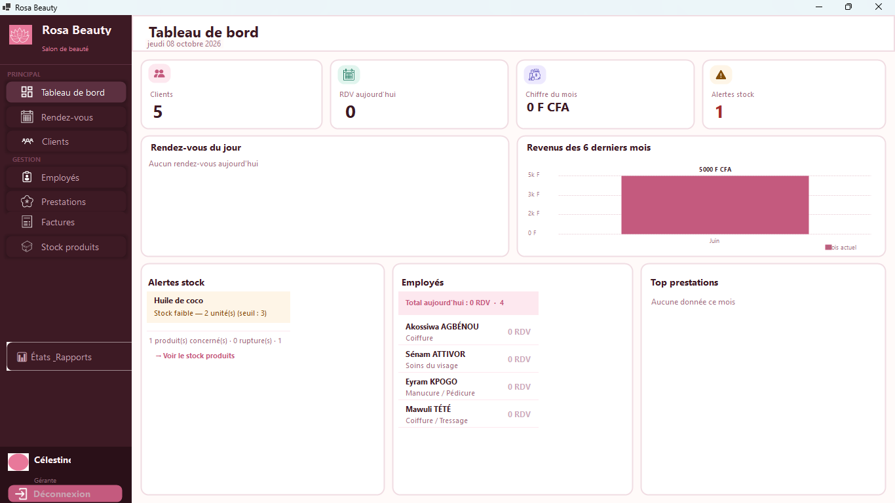

# BeautyManag (Rosa Beauty)

Application de bureau (Windows) pour gérer un salon de beauté : rendez-vous, clients, employés, prestations, factures PDF, stock de produits et chiffre d'affaires.



## Le problème

Les salons gèrent souvent rendez-vous et stock sur un cahier : doubles réservations, oublis, aucune vision des revenus réels.

## Fonctionnalités

- **Rendez-vous** : planning par employé, avec **détection des conflits d'horaire** (un employé ne peut pas avoir deux rendez-vous qui se chevauchent).
- **Clients, employés, prestations** : création, modification, recherche.
- **Facturation** : facture détaillée, génération et impression en PDF.
- **Produits et stock** : seuil d'alerte par produit, alertes de stock bas sur le tableau de bord.
- **Tableau de bord** : indicateurs du jour et chiffre d'affaires du mois en F CFA.
- Écran de connexion.

## Stack

VB.NET · Windows Forms · .NET (`net10.0-windows`) · MariaDB / MySQL (MySql.Data) · iTextSharp (PDF) · Guna.UI2, ReaLTaiizor, FontAwesome.Sharp (interface) · installeur Inno Setup qui embarque MariaDB.

## Architecture

```
Models/        Client, Employe, RendezVous, Prestation, Produit, Facture, connexion à la base
Controllers/   accès à la base et règles métier (un contrôleur par entité)
Views/         formulaires et contrôles utilisateur
utils/         états
```

## Essayer l'application (le plus simple)

1. Télécharger `BeautyManager_Setup_v1.0.exe` dans la page [Releases](https://github.com/clever75/BeautyManag/releases) et lancer l'installeur (droits administrateur demandés).
2. L'installeur met en place l'application, **sa propre base MariaDB** (service Windows `BeautyManagerDB`, port 3309), les tables et des données de démonstration. Il n'y a pas besoin d'installer MySQL.
3. Lancer BeautyManager et se connecter avec le compte de démonstration ci-dessous.

Si l'application ne démarre pas, installer le runtime « .NET Desktop 10 » de Microsoft.

## Compte de démonstration

| Identifiant | Mot de passe |
|-------------|--------------|
| `gerante`   | `rosa2024`   |

Compte fictif créé par l'installeur, uniquement pour tester.

## Installation pour le développement

Prérequis : Visual Studio avec la charge de travail « Développement .NET Desktop » et le SDK .NET 10, MariaDB ou MySQL (XAMPP convient).

1. Créer la base `salonbeaute`, puis importer `database/schema.sql` (tables) et `database/seed.sql` (données de démonstration et compte).
2. Ouvrir `BeautyManager.slnx` dans Visual Studio, restaurer les paquets NuGet, lancer (F5).

La connexion à la base se règle dans un fichier `config.properties` placé à côté de l'exécutable (jamais envoyé sur GitHub). **Sans ce fichier**, l'application utilise les réglages de développement `localhost:3306`, utilisateur `root`, mot de passe vide (XAMPP). Format du fichier :

```properties
db.host=127.0.0.1
db.port=3306
db.name=salonbeaute
db.user=root
db.password=
```

## Ce que j'ai appris

- Découvrir une nouvelle stack (VB.NET, Windows Forms) après Java et PHP, et m'y adapter vite.
- Modéliser un domaine métier différent : planning, conflits d'horaires, facturation, stock.
- Générer des factures PDF et empaqueter l'application pour Windows, base de données comprise.

## Limites connues et pistes d'amélioration

- Les mots de passe des utilisateurs de l'application sont stockés en clair dans la table `utilisateur` : remplacement par un hachage prévu.
- Pas de tests automatisés.

## Contexte

Projet réalisé en 2026 dans le cadre du BTS en développement d'applications à DEFITECH (Lomé).

**Auteur** : ASSAN Ablavi Clever, [GitHub](https://github.com/clever75)
